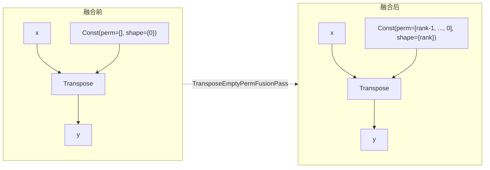

# TransposeEmptyPermFusionPass

## 融合模式

该融合用于补齐 ONNX `Transpose` 算子未携带 `perm` 属性时的默认逆序语义：将图中 `perm` 输入为空 Const 的 `Transpose` 节点，改写为携带完整逆序 perm（`perm = [rank-1, ..., 0]`，rank 为数据输入 `x` 的维度数）的 `Transpose` 节点。

ONNX `Transpose` 的 `perm` 属性为可选：未提供时默认对输入维度逆序。ONNX 插件在解析阶段（输入 rank 未知）无法生成逆序 perm，因此保留一个空 perm Const（shape 为 `{0}`）作为占位；`TransposeInferShape` 阶段按逆序规则推导输出 shape；本融合在 InferShape 之后（rank 已知）运行，将空 perm Const 替换为携带逆序 perm 的独立 Const 节点，保证下游 Tiling/Kernel 能够消费完整的 perm。

融合前后图结构如下：

替换后 `Transpose` 节点本身不变，仅将其 `perm` 输入的产生者由空 Const 改为携带逆序 perm 的新 Const（新 Const 的 perm 值为 `[rank-1, ..., 0]`、shape 为 `{rank}`，数据类型与原 perm Const 一致，为 INT32 或 INT64）；原空 Const 失去全部消费者后会被删除。`x` 的 shape 与 dtype、输出的 shape 均保持不变。

## 使用约束

- 结构约束：
  - 图中存在 `Transpose` 节点，输入为 `x`（数据）与 `perm`（Const），输出为 `y`。
  - `perm` 输入须来自 `Const`/`Constant` 节点，且其 value 的 shape 为空（shape 大小为 0），表示 ONNX 未提供 perm。
  - `x` 的维度数（rank）须已知且不小于 1；rank 未知或为标量时跳过该节点。
- 数据类型约束：
  - `perm` 的数据类型须为 INT32 或 INT64；其他数据类型打印告警并跳过。
  - 逆序 perm 保持与原 `perm` Const 相同的数据类型。
- 其他说明：
  - 显式提供非空 perm 的 `Transpose` 节点不受影响。
  - 被多个 `Transpose` 共享的空 perm Const，每个 `Transpose` 都会获得独立的逆序 perm Const；原共享 Const 不再被任何消费者引用时会被删除。

## 支持的型号

<!-- npu="950" id6 -->
Ascend 950PR&950DT系列产品
<!-- end id6 -->
