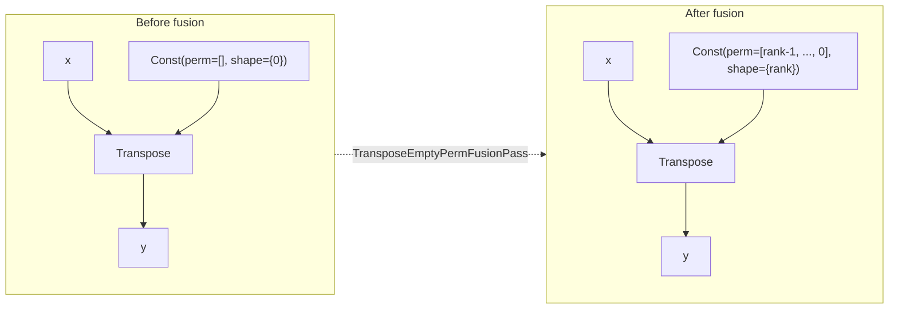

# TransposeEmptyPermFusionPass

## Fusion Pattern

This fusion completes the default reverse-permutation semantics of the ONNX `Transpose` operator when the `perm` attribute is absent: it rewrites a `Transpose` node whose `perm` input is an empty Const into a `Transpose` node carrying the full reverse permutation (`perm = [rank-1, ..., 0]`, where rank is the number of dimensions of the data input `x`).

The `perm` attribute of ONNX `Transpose` is optional: when it is not provided, the axes are reversed by default. The ONNX plugin cannot compute the reverse permutation at parse time (the input rank is still unknown), so it keeps an empty perm Const (shape `{0}`) as a placeholder; `TransposeInferShape` derives the output shape using the reverse rule; this fusion runs after InferShape (when the rank is known) and replaces the empty perm Const with a dedicated Const holding the reverse permutation, so that downstream Tiling/Kernel can consume a complete perm.

The graph structures before and after fusion are as follows:

After the replacement, the `Transpose` node itself is unchanged; only the producer of its `perm` input is switched from the empty Const to a new Const holding the reverse permutation (perm value `[rank-1, ..., 0]`, shape `{rank}`, data type identical to the original perm Const: INT32 or INT64). The original empty Const is removed once it has no remaining consumers. The shape and dtype of `x` and the output shape remain unchanged.

## Constraints

- Structural constraints:
  - The graph contains a `Transpose` node with input `x` (data) and `perm` (Const), and output `y`.
  - The `perm` input must come from a `Const`/`Constant` node whose value tensor has an empty shape (shape size 0), indicating that the ONNX `perm` attribute was not provided.
  - The rank of `x` must be known and not less than 1; nodes with unknown rank or scalar input are skipped.
- Data type constraints:
  - The data type of `perm` must be INT32 or INT64; other data types are skipped with a warning.
  - The reverse perm keeps the same data type as the original `perm` Const.
- Other notes:
  - `Transpose` nodes with an explicitly provided non-empty perm are not affected.
  - If an empty perm Const is shared by several `Transpose` nodes, each `Transpose` receives its own dedicated reverse-perm Const; the original shared Const is removed once no consumer references it.

## Applicable Products

<!-- npu="950" id6 -->
<term>Ascend 950PR&950DT products</term>
<!-- end id6 -->
