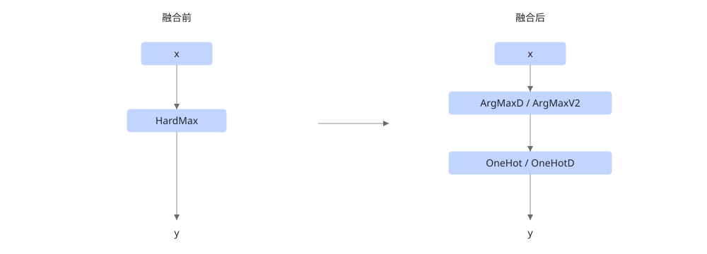

# HardMaxPass

## 融合模式

该融合将图中的 `HardMax` 算子替换为 `ArgMaxD` 或 `ArgMaxV2`，以及 `OneHot` 或 `OneHotD`。首先沿 `axis` 计算最大值下标，再将下标展开为独热张量。输出 shape 和数据类型与输入一致，选中位置的值为 1，其余位置的值为 0。

- `ArgMaxD` 和 `ArgMaxV2` 的选择取决于运行时对 `ArgMaxD` 的支持查询：支持时使用 `ArgMaxD`，不支持或查询失败时使用 `ArgMaxV2`。
- Ascend 950PR&950DT 时使用 `OneHot`，其他情况使用 `OneHotD`。`depth` 取输入 shape 在 `axis` 处的维度，`on_value` 和 `off_value` 分别为与输入类型一致的 1 和 0。

## 使用约束

- 版本约束：开源融合规则的编译和运行时 GE 编译器版本门槛均为 9.0.0。
- 数据类型约束：`HardMax` 输入仅支持 `FLOAT16`、`FLOAT`。
- 属性约束：`HardMax` 须携带 `axis` 属性，其取值范围为 `[-rank, rank)`，其中 `rank` 为输入维数；负值通过加 `rank` 转换为非负轴。
- shape 和格式约束：`depth` 从输入 shape 的 `axis` 维获取，替换图还须满足所选 `ArgMaxD`/`ArgMaxV2` 和 `OneHot`/`OneHotD` 算子的 shape、格式及推导约束。

## 支持的型号

<!-- npu="950" id1 -->
Ascend 950PR&950DT系列产品
<!-- end id1 -->

<!-- npu="A3" id2 -->
Atlas A2系列产品&Atlas A3系列产品
<!-- end id2 -->
