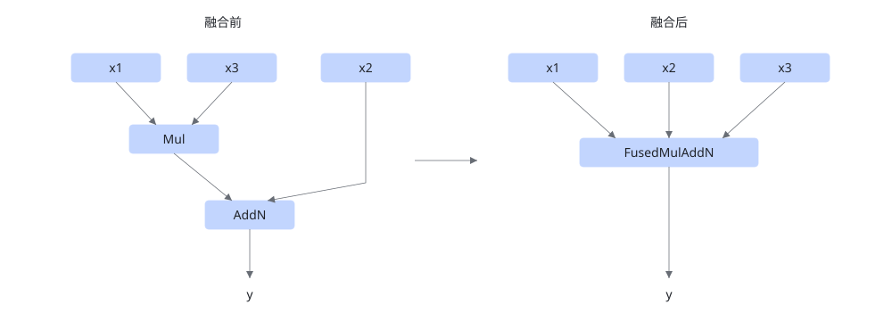
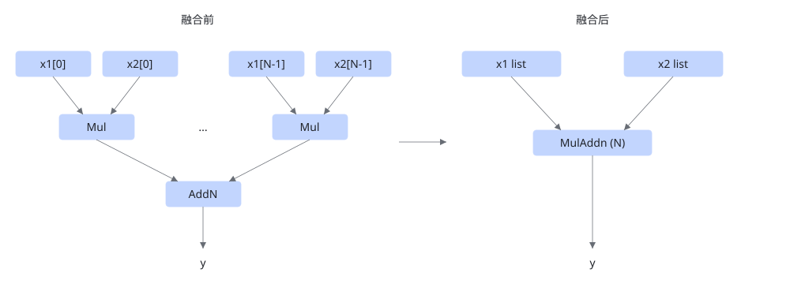

# MulAddNPass

## 融合模式

该融合将图中的 `Mul` 和 `AddN` 替换为融合算子，根据 `AddN` 的输入数量分为两种场景。

**场景一：`AddN` 有两个输入**

`AddN` 的第 0 个输入来自 `Mul`，第 1 个输入为 `x2`。`Mul` 的一个输入为标量或 shape 为 `[1]` 的张量 `x3`，另一个输入为 `x1`。替换后由 `FusedMulAddN` 计算 `y = x1 * x3[0] + x2`。

**场景二：`AddN` 在Mul节点个数大于2时**

`AddN` 的每个输入均来自一个 `Mul`。替换后将各 `Mul` 的第 0 个输入按 `AddN` 输入顺序组成 `x1` 列表，第 1 个输入组成 `x2` 列表，传入 `MulAddn`；其属性 `N` 为 `AddN` 的输入数量。

计算关系为 `y = sum(x1[i] * x2[i])`，其中 `i` 从 0 到 `N - 1`。

## 使用约束

- 版本约束：开源融合规则的编译和运行时 GE 编译器版本门槛均为 9.0.0。
- 结构约束：每个匹配的 `Mul` 有两个输入，其输出仅由该 `AddN` 消费；`Mul` 与 `AddN` 的 `_stream_label` 一致，缺省时按空字符串处理。
- 场景一：`Mul` 必须连接至 `AddN` 的第 0 个输入；`Mul` 至少有一个输入为 0 维标量或 shape 为 `[1]` 的张量。两个输入均满足时优先选取第 0 个作为 `x3`。该分支不额外校验数据类型和格式，实际支持范围以 `FusedMulAddN` 算子为准。
- 场景二：`AddN` 的 3 至 16 个输入必须全部来自 `Mul`；每个 `Mul` 的两个输入及 `AddN` 的第 0 个输入的数据类型须为 `FLOAT`、`FLOAT16` 或 `BFLOAT16`，数据格式须为 `ND`。每个 `Mul` 的两个输入均为 3 维，第 0 个输入的第 3 维为 1，第 1 个输入的第 2 维为 1，且第 3 维不大于 2040。其他 shape 和数据类型约束遵循 `MulAddn` 算子要求。

## 支持的型号

<!-- npu="950" id1 -->
Ascend 950PR&950DT系列产品：支持场景一。
<!-- end id1 -->

<!-- npu="A3" id2 -->
Atlas A2系列产品&Atlas A3系列产品：支持场景一和场景二。
<!-- end id2 -->
