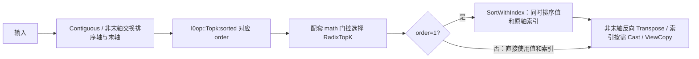

# aclnnSelectTopK

## 产品支持情况

<!-- npu="950" id1 -->
- <term>Ascend 950PR&950DT系列产品</term>：不支持
<!-- end id1 -->
<!-- npu="A3" id2 -->
- <term>Atlas A3系列产品</term>：支持
<!-- end id2 -->
<!-- npu="910b" id3 -->
- <term>Atlas A2系列产品</term>：支持
<!-- end id3 -->
<!-- npu="310b" id4 -->
- <term>Atlas 200I/500 A2推理产品</term>：不支持
<!-- end id4 -->
<!-- npu="310p" id5 -->
- <term>Atlas推理系列产品</term>：不支持
<!-- end id5 -->
<!-- npu="910" id6 -->
- <term>Atlas训练系列产品</term>：不支持
<!-- end id6 -->

## 功能说明

- 接口功能：沿指定维度，在每行给定区间内选取最大或最小的k个元素，支持仅输出值、仅输出索引或同时输出两者。
- 扩展能力：支持逐行区间、索引偏移、INT32/INT64索引和尾部填充；k可以大于排序轴或区间长度，输入和输出支持非连续Tensor。
- 计算规则：

  记输入维数为rank，归一化后的排序轴为d，轴长度为N。去掉d维后，其余各维按原顺序展开为rows行。第r行的有效元素数为：

  $$
  valid_r = \min(k, \max(e_r - b_r, 0))
  $$

  其中，$b_r$、$e_r$为beginOptional、endOptional指定的起止位置，分别默认为0、N，并截断到[0, N]。每行从左闭右开区间$[b_r, e_r)$中选取元素，结果写入前$valid_r$项，其余位置使用valueFill、indexFill填充。

  有效索引为原排序轴坐标加indicesOffset；填充索引直接使用indexFill，不叠加偏移。输出shape为self的shape将d维替换为k。
- 示例：

  输入`self = [9, 2, 7, 1, 5]`，`begin=1`，`end=4`，`k=4`，`largest=true`，`order=ACLNN_SELECT_TOP_K_ORDER_VALUE`，`indicesOffset=10`，`valueFill=-99`，`indexFill=-1`：

  - values：`[7, 2, 1, -99]`
  - indices：`[12, 11, 13, -1]`

## 函数原型

本算子采用[两段式接口](../../../docs/zh/context/two_phase_api.md)，先调用`aclnnSelectTopKGetWorkspaceSize`获取计算所需workspace大小及包含算子计算流程的执行器，再调用`aclnnSelectTopK`执行计算。

```cpp
aclnnStatus aclnnSelectTopKGetWorkspaceSize(
    const aclTensor* self,
    int64_t k,
    int64_t dim,
    bool largest,
    aclDataType indicesType,
    int64_t order,
    int64_t indicesOffset,
    int64_t outputMode,
    const aclTensor* beginOptional,
    const aclTensor* endOptional,
    const aclScalar* valueFill,
    int64_t indexFill,
    aclTensor* valuesOutOptional,
    aclTensor* indicesOutOptional,
    uint64_t* workspaceSize,
    aclOpExecutor** executor);
```

```cpp
aclnnStatus aclnnSelectTopK(
    void* workspace,
    uint64_t workspaceSize,
    aclOpExecutor* executor,
    aclrtStream stream);
```

### 枚举说明

| 枚举                                  | 值 | 含义                                              |
| ------------------------------------- | -- | ------------------------------------------------- |
| `ACLNN_SELECT_TOP_K_ORDER_NONE`     | 0  | 不排序，不保证有效结果顺序                        |
| `ACLNN_SELECT_TOP_K_ORDER_VALUE`    | 1  | 有效结果按值排序：`largest=true` 降序，反之升序 |
| `ACLNN_SELECT_TOP_K_ORDER_INDEX`    | 2  | 按索引排序的预留值，当前传入会报错                |
| `ACLNN_SELECT_TOP_K_OUTPUT_VALUES`  | 0  | 仅输出值                                          |
| `ACLNN_SELECT_TOP_K_OUTPUT_INDICES` | 1  | 仅输出索引                                        |
| `ACLNN_SELECT_TOP_K_OUTPUT_BOTH`    | 2  | 同时输出值和索引                                  |

## aclnnSelectTopKGetWorkspaceSize

- **参数说明**

  <table style="table-layout: fixed; width: 1500px"><colgroup>
  <col style="width: 220px">
  <col style="width: 100px">
  <col style="width: 240px">
  <col style="width: 440px">
  <col style="width: 170px">
  <col style="width: 130px">
  <col style="width: 100px">
  <col style="width: 100px">
  </colgroup>
  <thead>
    <tr>
      <th>参数名</th><th>输入/输出</th><th>描述</th><th>使用说明</th>
      <th>数据类型</th><th>数据格式</th><th>维度(shape)</th><th>非连续Tensor</th>
    </tr>
  </thead>
  <tbody>
    <tr>
      <td>self（const aclTensor*）</td><td>输入</td><td>输入张量。</td>
      <td><ul><li>不可为nullptr，支持空Tensor。</li><li>排序轴长度N不超过INT32_MAX。</li></ul></td>
      <td>FLOAT、FLOAT16、BFLOAT16</td><td>ND等公开格式</td><td>1-8</td><td>√</td>
    </tr>
    <tr>
      <td>k（int64_t）</td><td>输入</td><td>每行输出的元素个数。</td>
      <td>范围为[0, INT32_MAX]。允许大于N或区间长度，不足部分填充；k=0时输出为空。</td>
      <td>-</td><td>-</td><td>-</td><td>-</td>
    </tr>
    <tr>
      <td>dim（int64_t）</td><td>输入</td><td>排序维度。</td>
      <td>范围为[-rank, rank-1]，负值加rank归一化。</td>
      <td>-</td><td>-</td><td>-</td><td>-</td>
    </tr>
    <tr>
      <td>largest（bool）</td><td>输入</td><td>true取最大值，false取最小值。</td>
      <td>-</td><td>-</td><td>-</td><td>-</td><td>-</td>
    </tr>
    <tr>
      <td>indicesType（aclDataType）</td><td>输入</td><td>输出索引的数据类型。</td>
      <td>仅接受ACL_INT32或ACL_INT64。仅输出值时也须传入合法类型。</td>
      <td>-</td><td>-</td><td>-</td><td>-</td>
    </tr>
    <tr>
      <td>order（int64_t）</td><td>输入</td><td>有效结果的排列方式。</td>
      <td>支持ACLNN_SELECT_TOP_K_ORDER_VALUE和ACLNN_SELECT_TOP_K_ORDER_NONE，详见枚举说明。当order=0时，输出不保证有序或无序。</td>
      <td>-</td><td>-</td><td>-</td><td>-</td>
    </tr>
    <tr>
      <td>indicesOffset（int64_t）</td><td>输入</td><td>有效原轴索引的标量偏移。</td>
      <td>偏移后的完整原轴索引范围须能由indicesType表示；不叠加到indexFill。</td>
      <td>-</td><td>-</td><td>-</td><td>-</td>
    </tr>
    <tr>
      <td>outputMode（int64_t）</td><td>输入</td><td>选择输出值、索引或两者。</td>
      <td>取值见枚举说明。未启用的输出指针必须为nullptr。</td>
      <td>-</td><td>-</td><td>-</td><td>-</td>
    </tr>
    <tr>
      <td>beginOptional（const aclTensor*）</td><td>输入</td><td>每行区间的起点，包含该位置。</td>
      <td><ul><li>可为nullptr，表示从0开始。</li><li>元素数为rows或1，单元素广播到全部行。</li><li>端点截断到[0, N]。</li></ul></td>
      <td>INT32</td><td>ND等公开格式</td><td>元素数为rows或1</td><td>√</td>
    </tr>
    <tr>
      <td>endOptional（const aclTensor*）</td><td>输入</td><td>每行区间的终点，不包含该位置。</td>
      <td><ul><li>可为nullptr，表示到N结束。</li><li>其他要求同beginOptional。</li><li>截断后end≤begin表示空区间。</li></ul></td>
      <td>INT32</td><td>ND等公开格式</td><td>元素数为rows或1</td><td>√</td>
    </tr>
    <tr>
      <td>valueFill（const aclScalar*）</td><td>输入</td><td>尾部值填充标量。</td>
      <td>nullptr表示填0；非空时须可转换为ACL_FLOAT，先转为float，再转为self类型。</td>
      <td>可转换为FLOAT的标量类型</td><td>-</td><td>-</td><td>-</td>
    </tr>
    <tr>
      <td>indexFill（int64_t）</td><td>输入</td><td>尾部索引填充值。</td>
      <td>须能由indicesType表示；原样写入，不叠加indicesOffset。</td>
      <td>-</td><td>-</td><td>-</td><td>-</td>
    </tr>
    <tr>
      <td>valuesOutOptional（aclTensor*）</td><td>输出</td><td>TopK的值。</td>
      <td><ul><li>调用者预分配，shape为self的shape将dim维替换为k。</li><li>输出值时不可为nullptr；仅输出索引时必须为nullptr。</li></ul></td>
      <td>与self一致</td><td>ND等公开格式</td><td>与self维数一致</td><td>√</td>
    </tr>
    <tr>
      <td>indicesOutOptional（aclTensor*）</td><td>输出</td><td>TopK的索引。</td>
      <td><ul><li>调用者预分配，shape同值输出。</li><li>输出索引时不可为nullptr；仅输出值时必须为nullptr。</li></ul></td>
      <td>由indicesType指定</td><td>ND等公开格式</td><td>与self维数一致</td><td>√</td>
    </tr>
    <tr>
      <td>workspaceSize（uint64_t*）</td><td>输出</td><td>返回Device侧所需workspace大小，单位为字节。</td>
      <td>不可为nullptr。</td><td>-</td><td>-</td><td>-</td><td>-</td>
    </tr>
    <tr>
      <td>executor（aclOpExecutor**）</td><td>输出</td><td>返回包含完整计算流程的执行器。</td>
      <td>不可为nullptr，用于第二段接口。</td><td>-</td><td>-</td><td>-</td><td>-</td>
    </tr>
  </tbody></table>

  公开格式包括ND、NC、NCL、NCHW等普通步长格式，不支持私有存储格式。区间张量按除dim外各维的原顺序逐行对应，shape无需与行shape一致；负端点截断为0，不按负下标解释。
- **返回值**

  aclnnStatus：成功返回`ACLNN_SUCCESS`，其他状态码参见[aclnn返回码](../../../docs/zh/context/aclnn_return_code.md)。主要异常如下：

  <table style="table-layout: fixed; width: 1000px"><colgroup>
  <col style="width: 300px"><col style="width: 150px"><col style="width: 550px">
  </colgroup>
  <thead>
    <tr><th>返回值</th><th>错误码</th><th>描述</th></tr>
  </thead>
  <tbody>
    <tr><td>ACLNN_ERR_PARAM_NULLPTR</td><td>161001</td><td>self、workspaceSize或executor为空指针。</td></tr>
    <tr><td>ACLNN_ERR_PARAM_INVALID</td><td>161002</td><td>参数范围、数据类型、shape、格式、输出指针组合或产品架构不符合要求，包括启用的输出为空或未启用的输出非空。</td></tr>
    <tr><td>ACLNN_ERR_INNER_NULLPTR</td><td>561103</td><td>缺少配套的ops-math实现，或构建内部张量、算子失败。</td></tr>
  </tbody></table>

  执行器创建或框架资源分配失败时，还可能返回其他框架错误码。

## aclnnSelectTopK

- **参数说明**

  <table style="table-layout: fixed; width: 1000px"><colgroup>
  <col style="width: 220px"><col style="width: 100px"><col style="width: 680px">
  </colgroup>
  <thead>
    <tr><th>参数名</th><th>输入/输出</th><th>描述</th></tr>
  </thead>
  <tbody>
    <tr><td>workspace（void*）</td><td>输入</td><td>按第一段接口查询结果分配的Device侧内存；大小为0时可为nullptr，须保持有效直到流执行完成。</td></tr>
    <tr><td>workspaceSize（uint64_t）</td><td>输入</td><td>第一段接口返回的workspace大小，单位为字节。</td></tr>
    <tr><td>executor（aclOpExecutor*）</td><td>输入</td><td>第一段接口返回的执行器，包含本次输入、输出及计算流程。</td></tr>
    <tr><td>stream（aclrtStream）</td><td>输入</td><td>执行计算的Stream。读取输出或释放相关内存前须等待Stream执行完成。</td></tr>
  </tbody></table>
- **返回值**

  aclnnStatus：成功返回`ACLNN_SUCCESS`，其他状态码参见[aclnn返回码](../../../docs/zh/context/aclnn_return_code.md)。接口异步执行，设备计算结果还须检查流同步状态。

## 约束说明

- 确定性计算：
  - aclnnSelectTopK默认确定性实现
- `ORDER_VALUE`仅保证有效结果按值排序，填充部分不参与排序；`ORDER_NONE`不保证顺序。相等值不保证稳定排序，同时输出值和索引时两者逐项对应。
- indicesOffset须满足`type_min ≤ indicesOffset ≤ type_max - max(N-1, 0)`，indexFill须在同一类型范围内，其中type_min、type_max为indicesType的取值边界。仅输出值时也校验这两个参数；indexFill可与有效索引相同，不能用其数值判断有效项数。
- 维度乘积不得溢出INT64，`rows×N`和`rows×k`均不得超过`INT64_MAX/sizeof(int64_t)`。
- `rows=0`或`k=0`时，参数和产品检查通过后返回workspaceSize为0的空执行器。
- `N=0、rows>0、k>0`时仍执行填充，全部输出使用valueFill、indexFill。
- 不支持按索引排序，也不提供遇到NaN中止或按行输出哨兵值的语义。

## RadixTopK调用路径

在当前支持的轴长范围 `N≤INT32_MAX` 内，全轴（begin/end均为空）、双输出、offset=0、
`K≤N` 的FP16/BF16请求采用以下门控：`K≥8`，且 `12000000≤N<100000000` 时
`N>100K`，或 `N≥100000000` 时 `N>50K`。
区间、偏移、单输出、需要填充及不满足门控的请求继续走SelectTopK。

### 门控后：RadixTopK与SortWithIndex



该分流保持输入原维数，不额外Reshape，也不从原输入回读值。按值排序时调用
`SortWithIndex(values, indices, lastDim, largest, true)`，同时重排值和原轴索引；
只有 order=1 执行此排序，
order=0直接使用Radix的值和原轴索引，不保证输出顺序，相同值的索引选择不保证稳定。
INT64中间索引直接透传；当前接口轴长上限内实际使用INT32中间索引。

该路径要求配套的Topk/RadixTopK实现支持上述 K≥8 门控；有序分流还要求
SortWithIndex在A2/A3上支持FP16/BF16值和原轴索引的同步排序。
NaN输出沿用aclnnTopk的规范化行为（FP16/BF16为0x7fff），不保留其原始载荷和符号；
非 NaN 值和未命中此分流的 SelectTopK 路径保持原值位模式。
所有准备、选择、SortWithIndex、Cast和输出恢复均计入完整L2成本。

## 调用示例

以下示例展示两段式调用。调用前须初始化ACL、选择A2或A3并创建stream，准备self为`[2,5]`的FLOAT设备张量、values为`[2,3]`的FLOAT张量、indices为`[2,3]`的INT64张量。张量及底层设备内存由调用方创建和释放；具体编译和执行过程参见[编译与运行样例](../../../docs/zh/context/compile_and_run_sample.md)。

```cpp
#include "acl/acl.h"
#include "aclnn_select_top_k.h"

// 查询并执行标准模式；调用方在返回后检查状态并读取输出。
int RunStandardTopk(const aclTensor* self, aclTensor* values, aclTensor* indices, aclrtStream stream)
{
    constexpr int64_t OUTPUT_COUNT = 3;
    constexpr int64_t LAST_AXIS = -1;
    constexpr int64_t UNUSED_INDEX_FILL = -1;
    uint64_t workspaceSize = 0;
    aclOpExecutor* executor = nullptr;
    auto status = aclnnSelectTopKGetWorkspaceSize(
        self, OUTPUT_COUNT, LAST_AXIS, true, ACL_INT64, ACLNN_SELECT_TOP_K_ORDER_VALUE,
        0, ACLNN_SELECT_TOP_K_OUTPUT_BOTH, nullptr, nullptr, nullptr, UNUSED_INDEX_FILL,
        values, indices, &workspaceSize, &executor);
    if (status != ACL_SUCCESS) {
        return status;
    }
    void* workspace = nullptr;
    if (workspaceSize != 0) {
        const auto allocStatus = aclrtMalloc(&workspace, workspaceSize, ACL_MEM_MALLOC_HUGE_FIRST);
        if (allocStatus != ACL_SUCCESS) {
            return allocStatus;
        }
    }
    status = aclnnSelectTopK(workspace, workspaceSize, executor, stream);
    const auto syncStatus = aclrtSynchronizeStream(stream);
    if (workspace != nullptr) {
        aclrtFree(workspace);
    }
    return status == ACL_SUCCESS ? syncStatus : status;
}
```

输入`self = [[4,1,7,2,5],[0,8,3,6,9]]`时，输出values为`[[7,5,4],[9,8,6]]`，indices为`[[2,4,0],[4,1,3]]`。
